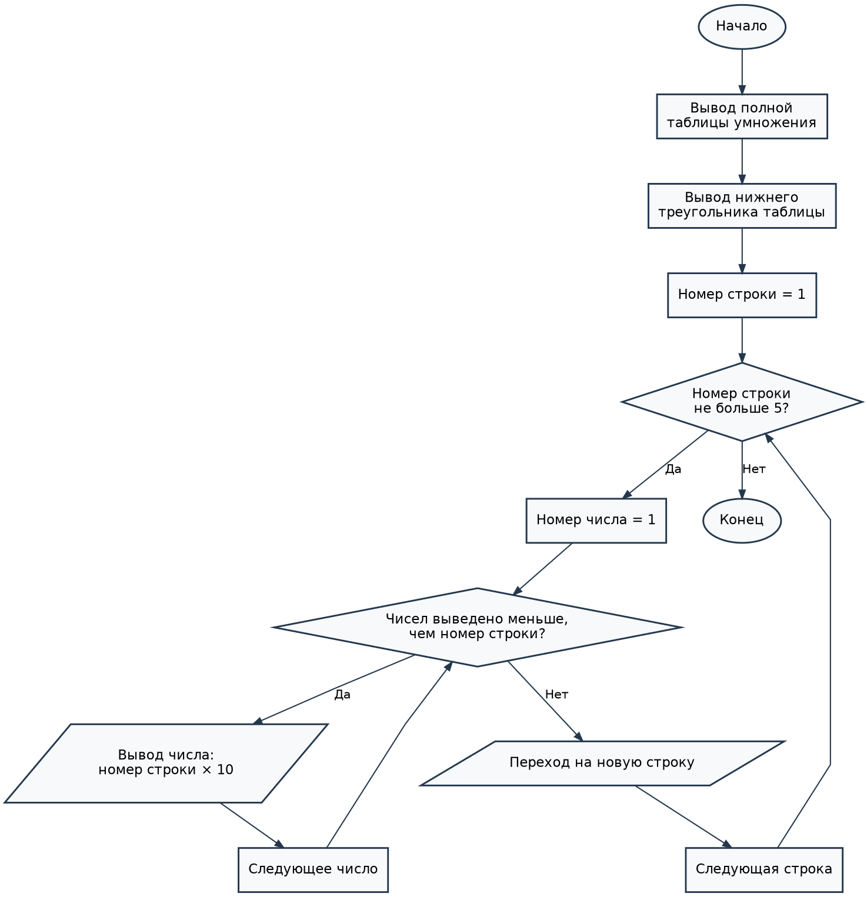

# Лабораторная работа № 9 — Задание 3, вариант 8

## Условие задачи
Вывести остроугольный треугольник с помощью выбранного пользователем символа. В варианте указаны угол `a` и сторона `s`. Для однозначного построения в консоли принята **равнобедренная** форма, где `s` — основание, `a` — угол при основании. Рисунок схематичный, поскольку символы консоли имеют разные размеры по горизонтали и вертикали.

## 1. Алгоритм и блок-схема

1. Ввести символ, длину основания `s` и угол `a`.
2. Проверить, что основание нечётное, от 5 до 79, а угол больше 45° и меньше 90°.
3. Вычислить примерную высоту изображения по тангенсу угла.
4. С помощью вложенных циклов `for` вывести контур треугольника: боковые стороны и основание.
5. Вывести параметры фигуры и завершить программу.

### Блок-схема



[Открыть блок-схему](images/block_scheme.png)

## 2. Реализация программы

Файл программы: [`../Task3.c`](../Task3.c). Язык C, Microsoft Visual Studio.

```c
#define _CRT_SECURE_NO_WARNINGS
#include <stdio.h>
#include <math.h>
#include <windows.h>

int main(void)
{
    int shirina, vysota, i, j, levo, pravo;
    char znak;
    double ugol, pi = 3.141592653589793;
    SetConsoleOutputCP(65001);

    printf("Вариант 8. Остроугольный треугольник.\n");
    printf("Введите символ: ");
    if (scanf(" %c", &znak) != 1) return 1;
    printf("Введите длину основания s (нечетное число от 5 до 79): ");
    if (scanf("%d", &shirina) != 1) return 1;
    printf("Введите угол a при основании (в градусах, от 46 до 89): ");
    if (scanf("%lf", &ugol) != 1) return 1;

    if (shirina < 5 || shirina > 79 || shirina % 2 == 0 || ugol <= 45 || ugol >= 90) {
        printf("Ошибка: нужна нечетная ширина 5..79 и угол 45..89 градусов.\n");
        return 1;
    }

    /* Рисуем равнобедренный остроугольный треугольник.
       Масштаб по строкам условный: символы консоли не квадратные. */
    vysota = (int)((shirina - 1) / 2.0 * tan(ugol * pi / 180.0) / 2.0 + 0.5);
    if (vysota < 2) vysota = 2;
    if (vysota > 35) vysota = 35;

    for (i = 0; i < vysota; i++) {
        levo = (shirina - 1) / 2 - i * ((shirina - 1) / 2) / (vysota - 1);
        pravo = shirina - 1 - levo;
        for (j = 0; j < shirina; j++) {
            if (i == vysota - 1 || j == levo || j == pravo)
                putchar(znak);
            else
                putchar(' ');
        }
        putchar('\n');
    }
    printf("Основание s = %d, угол a = %.1f градуса.\n", shirina, ugol);
    return 0;
}
```

## 3. Результат работы программы

Пример ввода: символ `*`, основание `9`, угол `60` градусов. Программа выводит контур треугольника из `*` и подпись с параметрами.

## 4. Информация о разработчике

Жаворонков Богдан, бТИИ-262.
